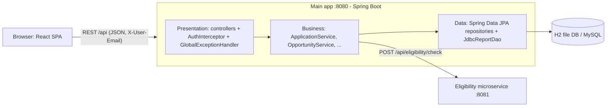

# Architecture

## Three-layer separation (CO-4)
| Layer | Package | Responsibility |
|---|---|---|
| Presentation | `web`, `config` | HTTP mapping, validation (`@Valid`), role checks, error JSON |
| Business | `service` | Rules: deadline, duplicates, eligibility, offer policy, transitions, openings |
| Domain / data | `domain`, `repository` | JPA entities, repositories, JDBC report |

## Service boundary (CO-5)
`eligibility-service` is a separate Spring Boot process with its own pom, port, tests and Dockerfile. It owns the eligibility rules
(CGPA, backlogs, department) and is stateless. The main app calls it via `EligibilityClient` (RestTemplate, 2 s connect / 3 s read timeouts).
If it is unreachable, `LocalEligibilityEvaluator` provides identical rules when `eligibility.fallback-enabled=true` (resilience pattern).

## Application lifecycle
`APPLIED → SHORTLISTED → INTERVIEW → OFFERED` ; any non-final state → `REJECTED` (officer) or `WITHDRAWN` (student). OFFERED/REJECTED/WITHDRAWN are final.
