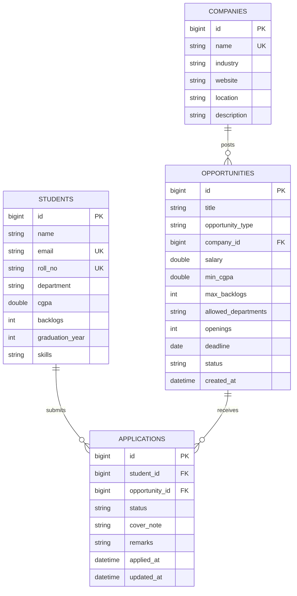

# ER Diagram

Constraints: `UNIQUE(student_id, opportunity_id)` on applications; FK deletes are blocked by the service layer (409) when referenced.
Full DDL: `db/schema.sql`. Sample queries: `db/queries.sql`.
